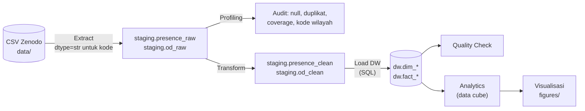
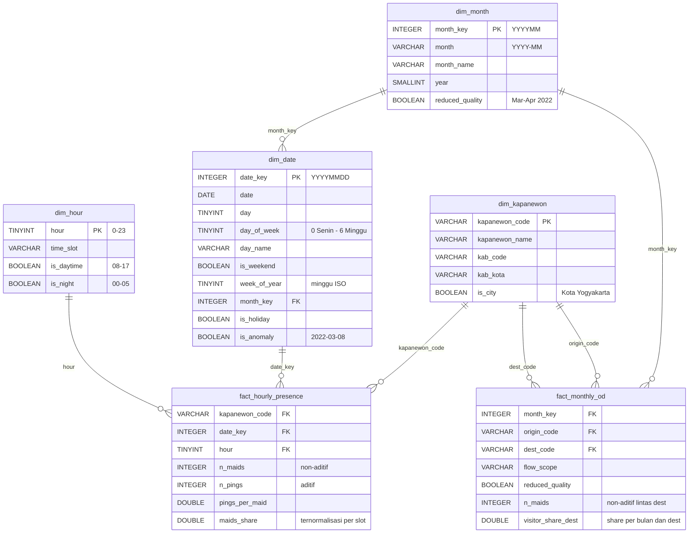

# Yogyakarta Mobility Analytics

Proyek kelompok mata kuliah Rekayasa Data (Post-UTS): **data pipeline (ETL) + data warehouse** untuk menganalisis mobilitas manusia di Daerah Istimewa Yogyakarta, memakai Pandas dan DuckDB.

**Pertanyaan analitik utama**

> Di mana pusat aktivitas siang hari di DIY, dari mana pengunjungnya berasal, dan bagaimana pola hariannya?

Rencana lengkap (desain skema, daftar QC, analisis yang direncanakan) ada di [PLAN.md](PLAN.md).

## Dataset

Dua sumber dari **JogjaPulse**, dataset agregat mobilitas berbasis lokasi device. Periode 1 Des 2021 – 30 Apr 2022, 78 kapanewon di 5 kab/kota, waktu WIB.

| File | Grain | Baris | Measure |
|---|---|---|---|
| `data/presence_kapanewon_hourly.csv` | kapanewon × tanggal × jam | 230.418 | `n_maids`, `n_pings` |
| `data/od_home_visits_kapanewon_monthly.csv` | bulan × origin × dest | 9.894 | `n_maids`, `reduced_quality` |

Aturan data yang memengaruhi semua analisis:

- **`n_maids` tidak aditif.** Ini jumlah device unik, jadi jangan di-`SUM` lintas jam, hari, atau kapanewon. Gunakan `AVG` atau `MEDIAN` per slot. `n_pings` boleh di-`SUM`.
- **Baris yang hilang berarti kurang dari 5 device** (disuppress demi privasi), bukan nol.
- **Ukuran sampel turun drastis** dari Desember ke April. Perbandingan antar waktu memakai metrik share (`maids_share`, `visitor_share_dest`), bukan angka mentah.
- **OD Mar–Apr 2022 berkualitas rendah** (`reduced_quality`). Data tetap disimpan, tetapi analisis kuantitatif OD hanya memakai Des 2021 – Feb 2022.
- **8 Mar 2022 adalah anomali** dan dikecualikan dari analisis tren.
- **Join memakai kode wilayah, bukan nama.** Nama `JETIS` ada di Bantul (`34.02.09`) dan Kota Yogyakarta (`34.71.02`).
- Satuan yang dihitung adalah **device**, bukan orang.

## Arsitektur pipeline



Seluruh pipeline ada di satu notebook, [main.ipynb](main.ipynb), dan disimpan di `db/mobility.duckdb` dengan dua schema: `staging` dan `dw`. Tabel dibuat dengan `CREATE OR REPLACE`, jadi notebook bisa dijalankan ulang kapan saja.

## Skema data warehouse

Skemanya **galaxy schema** (*fact constellation*): dua tabel fakta dengan grain waktu berbeda (jam dan bulan) yang berbagi dimensi `dim_kapanewon`. Di tabel OD, `dim_kapanewon` dipakai dua kali, sebagai origin dan sebagai dest.



| Tabel | Grain | Baris |
|---|---|---|
| `dw.dim_kapanewon` | 1 kapanewon | 78 |
| `dw.dim_date` | 1 hari | 151 |
| `dw.dim_hour` | 1 jam | 24 |
| `dw.dim_month` | 1 bulan | 5 |
| `dw.fact_hourly_presence` | kapanewon × tanggal × jam | 230.418 |
| `dw.fact_monthly_od` | bulan × origin × dest | 9.894 |

Catatan desain:

- Grain tiap fakta adalah kombinasi kolom FK-nya. Primary key dideklarasikan hanya di dimensi. **FK tidak dideklarasikan sebagai constraint** karena DuckDB menolak `CREATE OR REPLACE` pada tabel yang direferensikan FK. Integritas referensial dan duplikat grain diperiksa di section QC.
- `dim_date` dan `dim_hour` melayani presence (per jam), sedangkan `dim_month` melayani OD (per bulan). Keduanya sengaja tidak digabung menjadi satu `dim_time`.
- `maids_share` dan `visitor_share_dest` dihitung di SQL. Penyebut `maids_share` hanya mencakup kapanewon yang terpublikasi, jadi share wilayah rural pada jam sepi sedikit bias.

## Cara menjalankan

### Lokal (VS Code atau Jupyter)

```bash
git clone https://github.com/IlkhamAbdillah/yogyakarta-mobility-analytics.git
cd yogyakarta-mobility-analytics

python3 -m venv .venv
source .venv/bin/activate
pip install -r requirements.txt ipykernel
```

Buka `main.ipynb`, pilih kernel `.venv`, lalu jalankan **Restart & Run All**. Root repo dicari otomatis, jadi tidak ada path yang perlu diubah. Hasilnya ditulis ke `db/mobility.duckdb`.

### Google Colab

Sel setup pertama mendeteksi Colab, meng-*clone* repo dari GitHub, dan meng-install `requirements.txt` secara otomatis. Jalankan notebook dari atas ke bawah. Colab hanya melihat versi yang sudah di-push ke GitHub.

## Struktur repo

```
├── main.ipynb        # notebook utama (satu-satunya kode pipeline)
├── PLAN.md           # rencana, desain skema, daftar QC, checklist progres
├── requirements.txt
├── data/             # CSV sumber dari Zenodo (read-only)
├── db/               # mobility.duckdb (dibuat oleh notebook, tidak di-commit)
└── figures/          # gambar hasil visualisasi (dibuat saat tahap analitik)
```

## Status

- [x] Extract, staging raw, profiling, transform, staging clean
- [x] Build data warehouse (dimensi dan fakta)
- [x] Quality check
- [x] Analitik dan visualisasi
- [x] Kesimpulan dan keterbatasan

## Kesimpulan & Insight Utama

Ringkasan temuan dari analisis data cube (A1–A7) di [main.ipynb](main.ipynb):

- **Pusat tarikan & konsentrasi device ([A3](figures/A3_heatmap_urban.png), [A6](figures/A6_top_tujuan.png)):** **Depok (Sleman)** menarik pengunjung luar terbanyak (±9,2 rb device/bulan pada Des 2021 – Feb 2022), diikuti Banguntapan (±6,1 rb), Ngaglik (±5,9 rb), dan Gamping (±5,5 rb). Enam dari 10 tujuan teratas berada di Sleman, dua di Bantul, dan dua di Kota Yogyakarta. Di kawasan urban, Depok (±6,7%–9,5% share) dan Ngaglik stabil tinggi sepanjang hari.
- **Pola harian & rasio siang vs dini hari ([A1](figures/A1_pola_harian.png), [A2](figures/A2_rasio_siang_malam.png)):** Siklus 24 jam hari kerja dan akhir pekan berbentuk serupa. Dari 71 kapanewon ber-coverage ≥ 50%, rasio share siang (10–14) vs dini hari (00–05) memiliki median ±1,03 (rentang 0,28× di Gondomanan hingga 1,46× di Playen). Rasio siang tertinggi justru berada di wilayah rural Gunungkidul dan Kulon Progo, sedangkan inti kota mencatat rasio lebih rendah karena tingginya share dini hari (Gondomanan melonjak ke ±18,8% pada pukul 02.00)—yang juga dipengaruhi efek penyebut *zero-sum* ketika slot rural banyak disuppress.
- **Asal pengunjung & interaksi wilayah ([A5](figures/A5_matriks_od.png), [A6](figures/A6_asal_pengunjung.png)):** Pengunjung antar-kapanewon paling banyak berasal dari kab/kota sendiri (31,4%–63,7%, tertinggi Sleman 63,7%). **Sleman** menjadi asal luar terbesar bagi seluruh kab/kota lain (37,2% ke Kota Yogyakarta, 34,6% Bantul, 32,3% Kulon Progo, 30,4% Gunungkidul), diikuti Bantul ke Kota Yogyakarta (27,0%). Aliran level kapanewon terkonsentrasi di koridor bertetangga Sleman–Kota–Bantul.
- **Sensitivitas sampel & periode event ([A4](figures/A4_tren_harian.png), [A7](figures/A7_event.png)):** Rata-rata device terpublikasi per jam turun dari ±8,7 rb (Des) menjadi ±1,0 rb (Apr), dengan penurunan tajam sekitar 1 Jan, 16 Feb, dan anomali 8 Mar 2022 (±0,65 rb/jam), sehingga perbandingan antar waktu wajib memakai share. Pada Malam Tahun Baru (31 Des) dan Libur 1 Jan, tidak ada kenaikan share yang konsisten di kapanewon wisata (Kraton 0,84×/0,93× dan Gedongtengen 0,34×/0,61× justru di bawah hari biasa).

## Keterbatasan data

- **Device ≠ orang:** Yang dihitung adalah *device-presence*, bukan individu unik atau sensus penduduk.
- **Privacy suppression (`< 5` device):** Slot dengan kurang dari 5 device tidak dipublikasikan (bukan nol). Tujuh kapanewon di Gunungkidul punya coverage `< 50%`, dan hilangnya slot rural di dini hari memperbesar share wilayah urban pada penyebut.
- **Share bersifat *zero-sum*:** Kenaikan `maids_share` di satu kapanewon otomatis menekan share wilayah lain pada jam yang sama.
- **Ukuran sampel berubah antar waktu:** Penurunan tajam Des → Apr adalah perubahan komposisi sampel, bukan perubahan mobilitas; angka mentah tidak bisa dibandingkan langsung.
- **Kualitas OD Mar–Apr 2022 rendah (`reduced_quality`):** Tetap disimpan di DW, tetapi analisis kuantitatif OD dibatasi pada Des 2021 – Feb 2022.
- **Bias ukuran asal pada OD:** Dominasi Sleman sebagai asal pengunjung sebagian mencerminkan proporsi sampel device di Sleman yang memang terbesar (±45% share DIY).

## Anggota kelompok

Adnan, Aston, Muhammad Ilkham Abdillah, Juan, Natanael Sebastian Simanjuntak, Rafif Raihan Bahrul Alam, Rakan Hendian Ramadhan, Rian.

## Sitasi dataset

Widyawan (2026). *JogjaPulse: An Aggregated Spatio-Temporal Mobility Dataset for Yogyakarta, Indonesia.* Zenodo. https://doi.org/10.5281/zenodo.23157460
